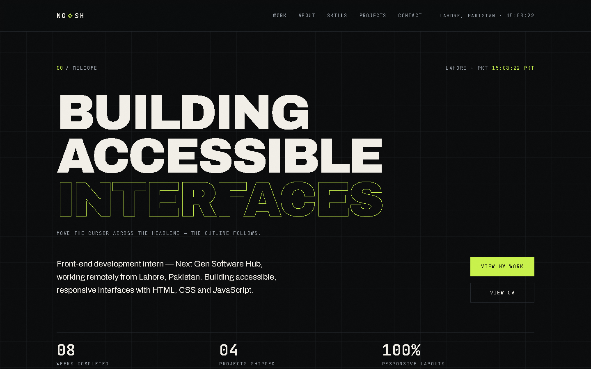
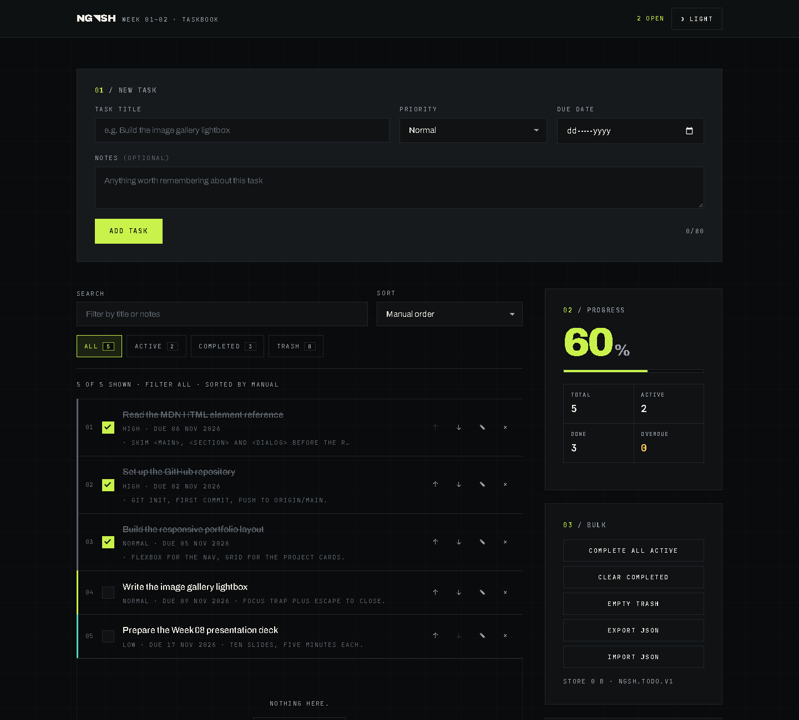
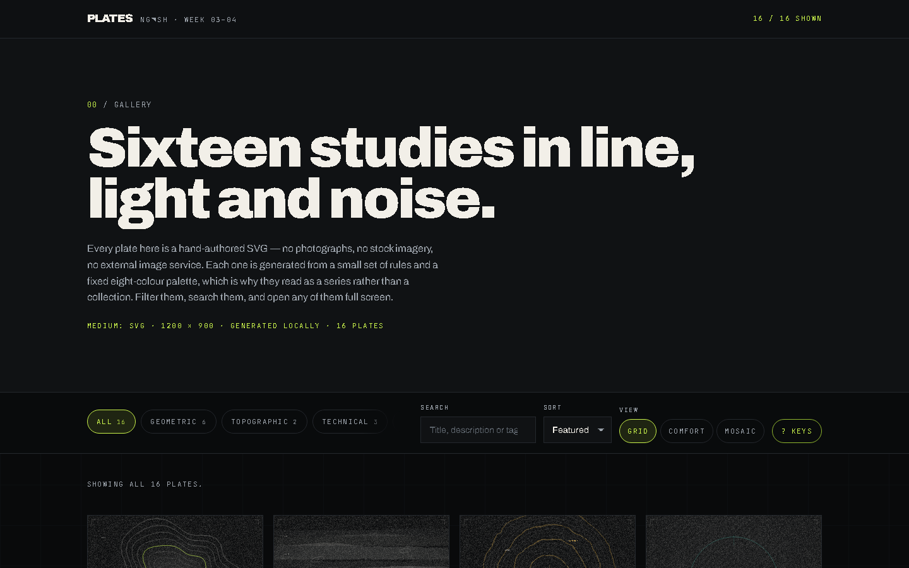
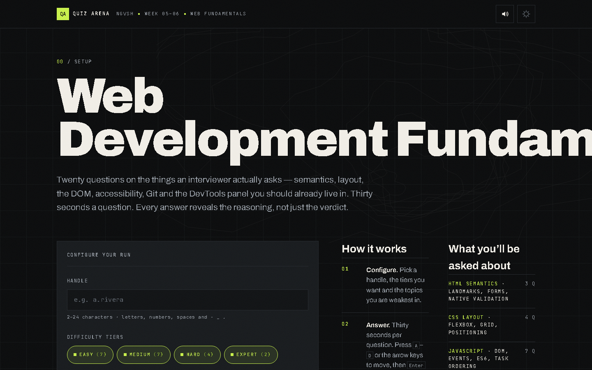
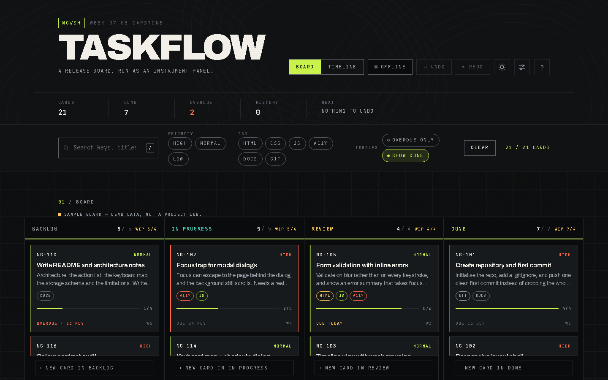

# NextGen Software Hub — Web Development Internship

**Intern:** Toheed Mehmood
**Programme:** Web Development Internship, eight weeks
**Stack:** HTML5, CSS3, vanilla JavaScript. No framework, no build step, no ES modules.
**Company:** Next Gen Software Hub Pvt. Ltd., Patna

Every project opens by double-clicking its `index.html`. The only network request is Google Fonts.

---

## Screenshots

Click a preview to open the project folder.

| Project | Preview |
| --- | --- |
| Task 1 — Portfolio | [](Task-1-Portfolio/) |
| Task 2 — Taskbook | [](Task-2-Taskbook/) |
| Task 3 — Plates | [](Task-3-Plates/) |
| Task 4 — Quiz Arena | [](Task-4-Quiz/) |
| Task 5 — TaskFlow | [](Task-5-TaskFlow/) |

---

## Projects

| Week | Project | Folder | Run |
| --- | --- | --- | --- |
| 01–02 | Personal portfolio with responsive layout | [`Task-1-Portfolio`](Task-1-Portfolio/) | [index.html](Task-1-Portfolio/index.html) |
| 01–02 | Taskbook: add, edit, delete, undo | [`Task-2-Taskbook`](Task-2-Taskbook/) | [index.html](Task-2-Taskbook/index.html) |
| 03–04 | Plates: gallery with filtering and lightbox | [`Task-3-Plates`](Task-3-Plates/) | [index.html](Task-3-Plates/index.html) |
| 05–06 | Quiz Arena: validation, errors, responsive | [`Task-4-Quiz`](Task-4-Quiz/) | [index.html](Task-4-Quiz/index.html) |
| 07 | TaskFlow: capstone Kanban application | [`Task-5-TaskFlow`](Task-5-TaskFlow/) | [index.html](Task-5-TaskFlow/index.html) |
| 08 | Final presentation, report and documentation | [`Task-6-Final-Presentation`](Task-6-Final-Presentation/) | [README](Task-6-Final-Presentation/README.md) |

The full internship report is [`Full-Internship-Report.pdf`](Full-Internship-Report.pdf). The editable source is in `Task-6-Final-Presentation/INTERNSHIP_REPORT.md`.

---

## Live demo with GitHub Pages

GitHub's file browser shows source code, not the rendered page. To open the projects in a
browser:

1. Open **Settings → Pages**.
2. Under **Build and deployment**, choose **Deploy from a branch**.
3. Branch: `main`, folder: `/ (root)`, then **Save**.
4. After a minute, the projects are available at:

```
https://toheedmalik321-cell.github.io/nextgen-internship/Task-1-Portfolio/
https://toheedmalik321-cell.github.io/nextgen-internship/Task-2-Taskbook/
https://toheedmalik321-cell.github.io/nextgen-internship/Task-3-Plates/
https://toheedmalik321-cell.github.io/nextgen-internship/Task-4-Quiz/
https://toheedmalik321-cell.github.io/nextgen-internship/Task-5-TaskFlow/
```

The portfolio's project cards use relative links to the sibling task folders, so they also work on GitHub Pages.

---

## Notes

- TaskFlow uses 21 clearly labelled sample cards. It is a demo of the board, not a log of internship work.
- The design system shared by all five projects is documented in `Task-6-Final-Presentation/DESIGN_SYSTEM.md`.
- Task 6 covers the Week 7–8 final presentation and documentation, as the brief lists five practical projects.

---

## Contact

Toheed Mehmood
Lahore, Pakistan (remote)

---

## License

All work in this repository was produced during an internship at Next Gen Software Hub Pvt. Ltd.
Under the internship terms, the intellectual property belongs to the company. See [LICENSE](LICENSE).
The repository is public for review only.
